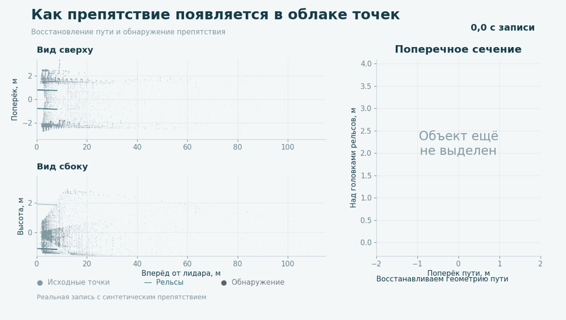

# Rail Inspector

Загрузите запись лидара из ROS 2 и посмотрите, что попадает в габарит поезда. Приложение строит ходовые и контактный рельсы, показывает поперечный срез по мере расчёта и сохраняет объекты для разбора после поездки.

Приложение воспроизводит запись по исходным временным меткам и выполняет расчёт текущей версией алгоритма. Для живого потока есть [ROS 2 Humble адаптер](docs/ROS2.md) с отдельным Docker-запуском. Управление торможением в этот проект не входит.

[Схема архитектуры](docs/PIPELINE_DIAGRAM.md) · [Как пользоваться демонстрацией](docs/WEB_GUIDE.md) · [Как работает метод](docs/ARCHITECTURE.md) · [История исследований](docs/RESEARCH.md)

**Версия 2026.10.23.** Обновлён поиск продолжения контактного рельса и сохранение согласующегося дальнего пути. [Что изменилось](docs/ALGORITHM_UPDATE.md) · [Результаты проверки](docs/RELEASE_VALIDATION.md).



[Демонстрация MP4](presentation/corrected_detection.mp4) · [Что показано в записи](presentation/README.md) · [О проекте и команде](docs/SUBMISSION.md)

## Запуск

Нужны **Git и Docker с Compose**. На Windows — Docker Desktop в режиме Linux containers. ROS 2, Python и Node на компьютере устанавливать не надо.

```sh
git clone https://github.com/HeinrichWirth/deptranshack.git
cd deptranshack
docker compose up --build -d
```

Откройте **http://localhost:8870**. Выберите `.db3`, дождитесь загрузки, выберите топик облака и нажмите **«Начать расчёт»**. Первый запуск скачает зависимости и соберёт C++-модули; следующие используют готовый образ.

Файл загружается внутрь Docker: во время расчёта нет медленного чтения bag через Windows bind mount. После расчёта временная копия удаляется. Сам файл на вашем компьютере не меняется. Результаты остаются в Docker volume после закрытия страницы и перезапуска контейнера.

## ROS 2 стенд

Для Ubuntu 22.04 / ROS 2 Humble используйте [инструкцию подключения](docs/ROS2.md). Адаптер принимает PointCloud2, запускает тот же алгоритм, обновляет веб-срез и публикует результат в `/rail_inspector/result`.

```sh
docker compose -f compose.ros2.yaml -f compose.ros2.host.yaml up --build -d
```

Дождитесь `READY` в журнале ROS-адаптера и запустите источник облаков или `ros2 bag play`. Для локального теста в Docker Desktop есть отдельный вариант без host network.

ROS 2 использует тот же обновлённый движок. Состояние проверок текущей версии приведено в [отчёте](docs/RELEASE_VALIDATION.md).

## Что смотреть

Подробная [инструкция по веб-демонстрации](docs/WEB_GUIDE.md) объясняет каждый экран, управление срезом и виртуальным поездом, цвета, таблицу объектов и экспорт. Для первого знакомства начните с неё.

- **Поперечный срез** обновляется по готовым результатам. Ползунок выбирает расстояние вдоль принятого пути. Контур — поезд 2,1 × 3 м, высота от головки рельса.
- **Красные точки** попали внутрь проверяемого габарита. Это ещё не отдельные подтверждённые объекты.
- **Расчёт алгоритма** — подготовка облаков, геометрия, защита и проверка препятствий, без загрузки файла и записи диагностики на диск.
- Снимите **«Следить за поездом»**, чтобы остановиться на интересном кадре. Кнопка **«Проехать по прогнозу»** открывает подробный просмотрщик: фиксированное облако, рельсы, срез и движение вдоль сохранённого пути.
- **Таблица объектов** появляется после завершения прогона. В ней группы с минимум двумя независимыми обнаружениями. Одиночные можно показать отдельно. У каждого объекта есть ссылки на кадры и выгрузка CSV/JSON.
- Близкие обнаружения автоматически собираются в один объект по пространственному окну 10 м. Ничего выделять и объединять вручную не нужно. Это грубое объединение: отдельные предметы ближе 10 м могут попасть в одну строку.

Белый путь в подробном просмотрщике — прогноз до защиты, цветной — принятый. За его концом не «свободно», а **неизвестно**.

## Подходящий вход

Поддерживается отдельный распакованный SQLite-файл **ROS 2 `.db3`**, сообщения `sensor_msgs/msg/PointCloud2`, сериализация CDR1. Если в bag несколько топиков, приложение предлагает выбрать облако. В других топиках сообщения не используются. IDs, timestamps и CDR-данные выбранного топика сохраняются.

Облако должно содержать `x`, `y`, `z`, `intensity`; координаты в метрах, LiDAR в центре поезда, **вперёд −Y, вправо +X, вверх +Z**. Это соглашение испытанной записи. Произвольный `frame_id` не преобразуется через TF автоматически. Приведите другой датчик к этим осям до загрузки. До 400 000 точек в кадре, до 50 ГБ на файл. Исследованный режим — 10 Гц, расчёт по контактному рельсу запрашивается 3 раза в секунду.

MCAP, сжатые `.zst`, несколько файлов split-bag и CDR2 пока не поддерживаются.

## Остановить и открыть снова

```sh
docker compose down
docker compose up -d
```

`down` сохраняет volume с результатами. **Не добавляйте `-v`, если они нужны.** Прерванный расчёт отмечается как прерванный; автоматического продолжения нет. Для повторного запуска загрузите исходный файл заново.

Выгрузить все сохранённые результаты в папку на компьютере:

```sh
docker compose cp inspector:/data/jobs ./saved-runs
```

## Проверка установки

Актуальное состояние сборки и доступных проверок: [RELEASE_VALIDATION.md](docs/RELEASE_VALIDATION.md).

```sh
docker compose exec inspector python -m unittest discover -s tests -v
docker compose logs --tail=80 inspector
```

Полная проверка через HTTP с вашим bag описана в [TESTING.md](docs/TESTING.md). История исследований и ограничения — в [RESEARCH.md](docs/RESEARCH.md). Структура кода, причинность и правила сопоставления объектов — в [ARCHITECTURE.md](docs/ARCHITECTURE.md).

## Измеренный результат

В проверенном Windows-прогоне на одинаковых причинных входах исправленный алгоритм впервые выделяет большой объект в **96,96 м**, подтверждает новым пакетом в **96,49 м** через **0,30 с**. Восстановленный путь при первом обнаружении доходит до **109,33 м** вперёд. Длина пути и дальность объекта - разные величины.

Проверка использует запись с синтетическими препятствиями и последовательные непересекающиеся пакеты по три скана. Это офлайн-проверка геометрии и трекера, без оценки скорости живого потока. Отдельные пакеты остаются без обнаружения при отказе ближней опоры или несовместимой геометрии. Параметры кластеризации и подтверждения объектов не менялись. Docker-сборка прошла функциональные тесты; точное совпадение её геометрии с Windows-прогоном не подтверждено, детали приведены в отчёте.

В Git нет исходных bag, LAS, пользовательских облаков и собранных бинарников. C++ собирается из включённых исходников. Для повторного расчёта нужен собственный входной файл; опубликованная анимация показывает сохранённые результаты. Подробности: [проверки](docs/RELEASE_VALIDATION.md), [метод](docs/TECHNICAL_NOTE.md), [запуск тестов](docs/TESTING.md).
